# Hermes Sysadmin · Active Directory

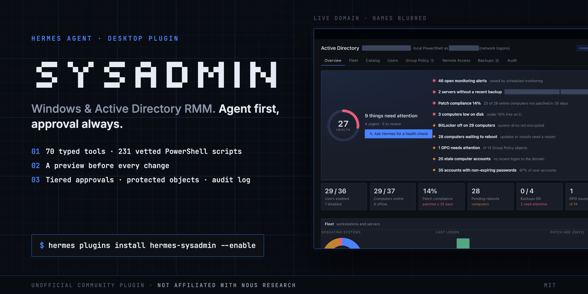

```sh
hermes plugins install kdegeek/hermessysadmin --enable
```

Or open `hermes://plugin/install?repo=kdegeek/hermessysadmin&enable=1` to install from Hermes Desktop. Screenshots are from a live domain; names, hosts and the domain are blurred.

Manage an on-prem Windows and Active Directory environment from Hermes Agent, with local PowerShell on a domain-joined Windows machine or over WinRM through a jump host. It covers users, groups and lockouts, Group Policy, RDP sessions and access, Windows Server Backup, and (new in 0.2) a desktop fleet with a catalog of 231 vetted PowerShell tasks, remote-access helpers and scheduled monitoring. Every change goes through typed tools with tiered approvals, protected objects and a local audit log. The plugin also ships workflow skills, `/ad` commands and a Hermes Desktop dashboard.

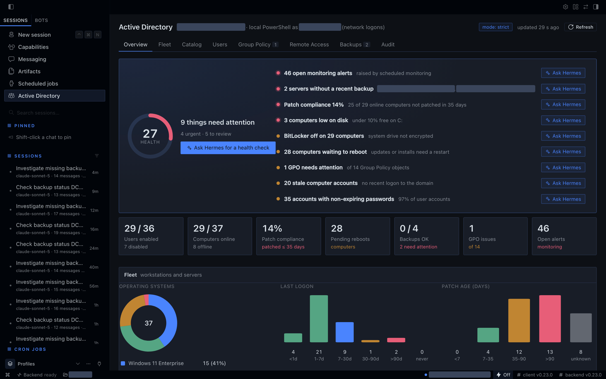

## Highlights

- **Agent first, with a full UI.** The overview scores the domain, lists what needs attention (stale backups, patch compliance, low disk, Defender, BitLocker, NLA, pending reboots, GPO problems, lockouts, monitoring alerts) and puts an **Ask Hermes** button on each item. It opens a new chat with a prompt that names the right skill and tells the agent to investigate read-only first. You read the prompt and press Enter.
- **Vetted scripts instead of improvised PowerShell.** 231 catalog entries with typed parameters, run the same way by you (generated forms) and by the agent (`catalog_run`). 195 are read-only. The 36 that change something show a preview of exactly what will change, computed on the target by the script itself, before you approve.
- **Safety you can see.** Tiered approvals (read, write, high-risk, protected), fleet escalation (more than 10 machines, an OU, or a DC raises a change to high-risk), protected accounts that no mode can touch, and an audit log of every attempt.
- **Remote help in one place.** Each computer's drawer shows its sessions with Shadow, Offer Remote Assistance and Log off, checks why remote access fails with a **Fix** button per check, and has a toolbox (message, lock, restart, gpupdate, restart service).
- **Runs where Hermes runs.** On a domain-joined Windows machine Hermes runs PowerShell locally, as an account you choose. Elsewhere it uses a WinRM jump host.

| Ask Hermes hands the problem to the agent | Every change shows a preview first |
|---|---|
| 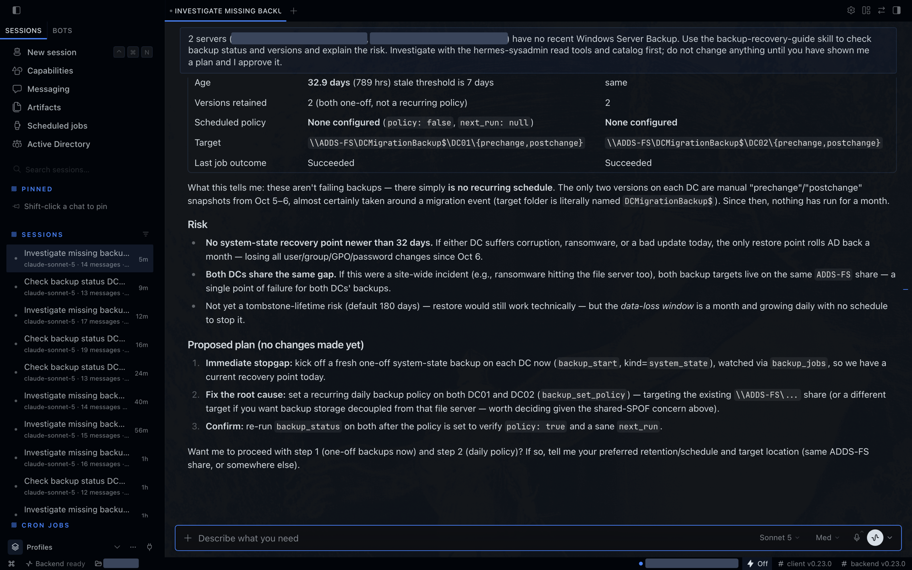 | 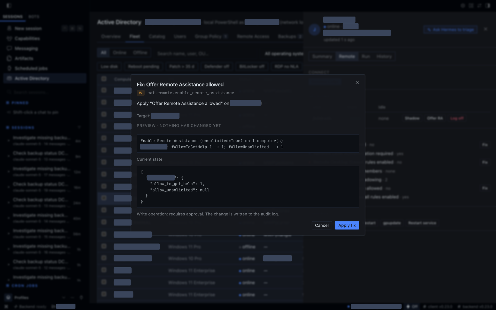 |
| **Catalog: 231 vetted scripts** | **Fleet drawer: sessions, checks, fixes, toolbox** |
| 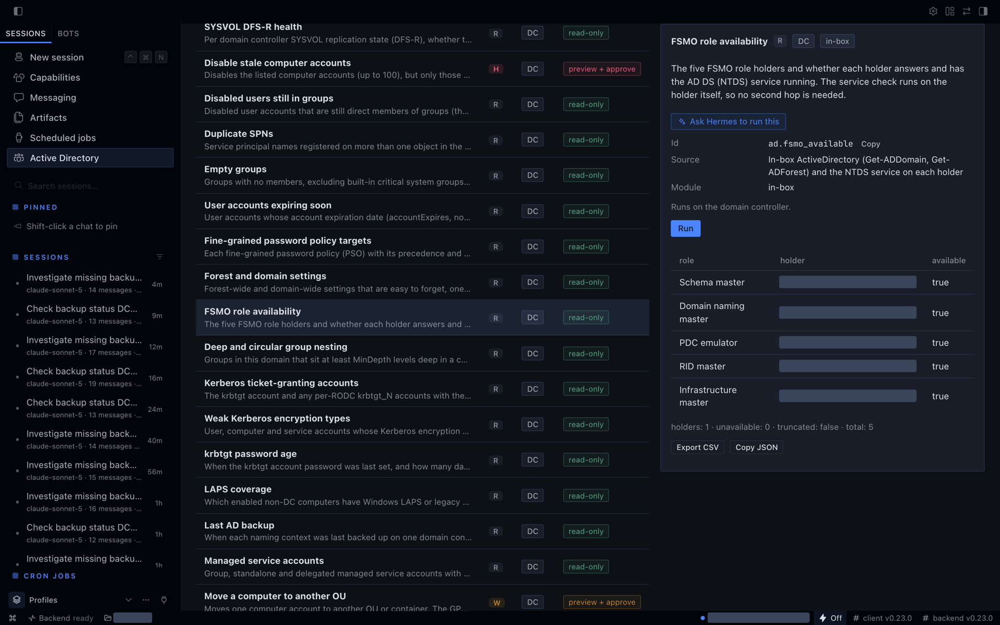 | 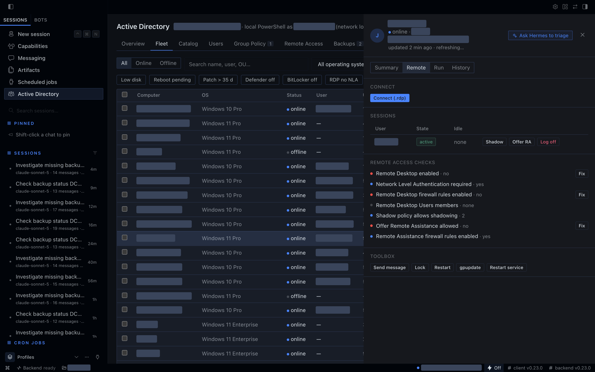 |

## What you get

71 typed tools in ten toolsets (domain 5, users and groups 17, Group Policy 16, RDP 10, backup 6, meta 2, fleet 3, catalog 5, remote 4, monitoring 3). One of them, the raw PowerShell escape hatch `ad_powershell`, is only registered when you turn it on, so a default install exposes 70.

| Surface | Agent tools | Dashboard |
|---|---|---|
| Domain | DC list and health (services, SYSVOL, time skew, replication), domain overview, search, connection test | Overview KPIs and DC table |
| Users and groups | get/list/create/update, reset password (one-time reveal), unlock, enable/disable, move, delete, group membership, lockout source, Recycle Bin | Users tab, drawer, dialogs |
| Group Policy | list with health, settings report, RSoP, link/unlink/enforce, status, security filtering, gpupdate, backup/restore/delete | Group Policy tab |
| Remote Access | sessions across servers, log off/disconnect/message, RDP and NLA toggles, Remote Desktop Users, `.rdp` Connect | Remote Access tab |
| Backup | Windows Server Backup status with staleness, versions, jobs, start/cancel, policy | Backups tab |
| Fleet | `fleet_inventory` (every AD computer: online state, disk, patch age, pending reboot, Defender, BitLocker, RDP/NLA), `fleet_device`, `fleet_history` snapshots | Fleet tab with filters, multi-select and a device drawer |
| Catalog | `catalog_search`, `catalog_get`, `catalog_run` over 231 vetted PowerShell entries, `catalog_module_status` | Catalog tab with generated parameter forms, target picker, preview and result tables |
| Remote access | `remote_sessions`, `remote_access_check` (names the fix entry for each failing check), `remote_assist_command`, `remote_shadow_command`, `rdp_connect_file` | Fleet drawer Remote section |
| Monitoring | `monitoring_enable`, `monitoring_status`, `monitoring_disable`: a Hermes cron job runs a watch script and reports new and resolved findings | Overview alerts |
| Meta | audit log query; optional raw PowerShell (off by default) | Audit tab |

Skills: `onboard-user`, `offboard-user`, `lockout-triage`, `gpo-change`, `domain-health-check`, `access-review`, `backup-recovery-guide`, `fleet-health-check`, `endpoint-triage`, `remote-assist`.

Commands: `/ad status`, `/ad user <name>`, `/ad unlock <name>`, `/ad sessions [host]`, `/ad backups`, `/ad catalog <query>`, `/ad run <id> key=value [on H1,H2]`.

## Catalog

231 vetted PowerShell entries, each a script in `catalog/<area>/<name>.ps1` with a YAML header (id, title, category, tier, target, module, parameters). Entries are reached through `catalog_search`, `catalog_get` and `catalog_run`, or the `/ad catalog` and `/ad run` commands; they are not separate agent tools. `target: endpoint` entries fan out from the PowerShell host (the Hermes machine on the local transport, the jump host over WinRM) to the chosen desktops (or every enabled workstation, or an OU); `target: dc` entries run on the PowerShell host and reach DC-local state (SYSVOL, DNS server, replication metadata, GPO backups) on a domain controller. The tables below are generated by `scripts/catalog_table.py` and checked by a test.

<!-- BEGIN CATALOG (generated by scripts/catalog_table.py) -->

#### Endpoint health (28)

| Id | Title | Tier | Target | Module |
|---|---|---|---|---|
| `endpoint.activation` | Windows activation status | R | endpoint | inbox:CimCmdlets |
| `endpoint.app_crashes` | Application crashes and hangs | R | endpoint | inbox:Microsoft.PowerShell.Diagnostics |
| `endpoint.battery` | Battery health | R | endpoint | inbox:CimCmdlets |
| `endpoint.boot_performance` | Boot time trend | R | endpoint | inbox:Microsoft.PowerShell.Diagnostics |
| `endpoint.component_health` | Component store health | R | endpoint | inbox:Dism |
| `endpoint.disk_usage` | Disk usage | R | endpoint | inbox:Storage |
| `endpoint.drivers` | Driver inventory | R | endpoint | inbox:CimCmdlets |
| `endpoint.hardware` | Hardware summary | R | endpoint | inbox:CimCmdlets |
| `endpoint.installed_software` | Installed software | R | endpoint | inbox:Microsoft.PowerShell.Management |
| `endpoint.largest_folders` | Largest folders under a path | R | endpoint | inbox:Microsoft.PowerShell.Management |
| `endpoint.os_version` | Windows version and build | R | endpoint | inbox:CimCmdlets |
| `endpoint.page_file` | Page file configuration and use | R | endpoint | inbox:CimCmdlets |
| `endpoint.pending_reboot` | Pending reboot | R | endpoint | inbox:Microsoft.PowerShell.Management |
| `endpoint.physical_disks` | Physical disk health | R | endpoint | inbox:Storage |
| `endpoint.power_settings` | Power plan and sleep settings | R | endpoint | inbox:CimCmdlets |
| `endpoint.problem_devices` | Devices with problems | R | endpoint | inbox:CimCmdlets |
| `endpoint.recent_errors` | Recent errors | R | endpoint | inbox:Microsoft.PowerShell.Diagnostics |
| `endpoint.reliability` | Reliability history summary | R | endpoint | inbox:CimCmdlets |
| `endpoint.resource_pressure` | CPU and memory pressure now | R | endpoint | inbox:CimCmdlets |
| `endpoint.scheduled_tasks` | Non-Microsoft scheduled tasks | R | endpoint | inbox:ScheduledTasks |
| `endpoint.service_accounts` | Services running as named accounts | R | endpoint | inbox:CimCmdlets |
| `endpoint.startup_items` | Startup items | R | endpoint | inbox:CimCmdlets |
| `endpoint.stopped_auto_services` | Stopped automatic services | R | endpoint | inbox:CimCmdlets |
| `endpoint.time_sync` | Time synchronisation status | R | endpoint | inbox:Microsoft.PowerShell.Management |
| `endpoint.top_processes` | Top processes | R | endpoint | inbox:Microsoft.PowerShell.Management |
| `endpoint.unexpected_shutdowns` | Unexpected shutdowns and bugchecks | R | endpoint | inbox:Microsoft.PowerShell.Diagnostics |
| `endpoint.uptime` | Uptime and last boot | R | endpoint | inbox:CimCmdlets |
| `endpoint.windows_features` | Installed roles and optional features | R | endpoint | inbox:CimCmdlets |

#### Security posture (32)

| Id | Title | Tier | Target | Module |
|---|---|---|---|---|
| `security.applocker_wdac` | AppLocker and WDAC posture | R | endpoint | inbox:AppLocker |
| `security.audit_policy` | Local audit policy | R | endpoint | inbox:Microsoft.PowerShell.Utility |
| `security.autorun_policy` | AutoRun and AutoPlay policy | R | endpoint | inbox:Microsoft.PowerShell.Management |
| `security.bitlocker_status` | BitLocker status | R | endpoint | inbox:CimCmdlets |
| `security.defender_asr` | Defender attack surface reduction rules | R | endpoint | inbox:Defender |
| `security.defender_exclusions` | Microsoft Defender exclusions | R | endpoint | inbox:Defender |
| `security.defender_quick_scan` | Start a Defender quick scan | W | endpoint | inbox:Defender |
| `security.defender_status` | Microsoft Defender status | R | endpoint | inbox:Defender |
| `security.defender_update_signatures` | Update Defender signatures | W | endpoint | inbox:Defender |
| `security.disable_llmnr` | Turn off LLMNR | W | endpoint | inbox:Microsoft.PowerShell.Management |
| `security.disable_smb1_server` | Turn off the SMB1 server protocol | W | endpoint | inbox:SmbShare |
| `security.enable_firewall_profiles` | Turn on all firewall profiles | W | endpoint | inbox:NetSecurity |
| `security.firewall_open_inbound` | Inbound firewall rules open to any address | R | endpoint | inbox:NetSecurity |
| `security.firewall_profiles` | Windows Firewall profiles | R | endpoint | inbox:NetSecurity |
| `security.guest_account` | Guest account state | R | endpoint | inbox:Microsoft.PowerShell.LocalAccounts |
| `security.laps_status` | LAPS configuration | R | endpoint | inbox:Microsoft.PowerShell.Management |
| `security.local_admins` | Local administrators | R | endpoint | inbox:Microsoft.PowerShell.LocalAccounts |
| `security.local_users` | Local user accounts | R | endpoint | inbox:Microsoft.PowerShell.LocalAccounts |
| `security.logon_screen_policy` | Screen lock and logon screen policy | R | endpoint | inbox:Microsoft.PowerShell.Management |
| `security.lsa_protection` | LSA protection, Credential Guard and WDigest | R | endpoint | inbox:CimCmdlets |
| `security.name_resolution` | LLMNR, NetBIOS, mDNS and WPAD exposure | R | endpoint | inbox:CimCmdlets |
| `security.ntlm_settings` | NTLM, LM hash and cached logon settings | R | endpoint | inbox:Microsoft.PowerShell.Management |
| `security.powershell_logging` | PowerShell v2 and logging policy | R | endpoint | inbox:Dism |
| `security.rdp_nla` | Remote Desktop and NLA posture | R | endpoint | inbox:Microsoft.PowerShell.Management |
| `security.schannel_ciphers` | SCHANNEL ciphers, hashes and .NET strong crypto | R | endpoint | inbox:Microsoft.PowerShell.Management |
| `security.secure_boot_tpm` | Secure Boot and TPM | R | endpoint | inbox:TrustedPlatformModule |
| `security.share_open_write` | Shares writable by broad groups | R | endpoint | inbox:SmbShare |
| `security.smb1` | SMB1 status | R | endpoint | inbox:SmbShare |
| `security.smb_signing` | SMB signing, encryption and SMB1 client | R | endpoint | inbox:SmbShare |
| `security.tls_protocols` | TLS and SSL protocol settings | R | endpoint | inbox:Microsoft.PowerShell.Management |
| `security.uac_settings` | User Account Control settings | R | endpoint | inbox:Microsoft.PowerShell.Management |
| `security.unquoted_service_paths` | Unquoted service paths | R | endpoint | inbox:CimCmdlets |

#### Patching (10)

| Id | Title | Tier | Target | Module |
|---|---|---|---|---|
| `patch.hotfix_history` | Installed hotfix history | R | endpoint | inbox:Microsoft.PowerShell.Management |
| `patch.install_failures` | Windows Update installation failures | R | endpoint | inbox:Microsoft.PowerShell.Diagnostics |
| `patch.office_c2r` | Microsoft 365 Apps (Click-to-Run) version and channel | R | endpoint | inbox:Microsoft.PowerShell.Management |
| `patch.patch_level` | Cumulative update level across computers | R | endpoint | inbox:CimCmdlets |
| `patch.pending_updates` | Pending Windows updates | R | endpoint | inbox:WindowsUpdateAgent |
| `patch.trigger_scan` | Start a Windows Update scan | W | endpoint | inbox:Microsoft.PowerShell.Management |
| `patch.wu_config` | Windows Update policy | R | endpoint | inbox:Microsoft.PowerShell.Management |
| `patch.wu_health` | Windows Update client health | R | endpoint | inbox:WindowsUpdateAgent |
| `patch.wu_history` | Windows Update history | R | endpoint | inbox:WindowsUpdateAgent |
| `patch.wu_install` | Install security and critical updates | H | endpoint | inbox:ScheduledTasks |

#### Users & sessions (8)

| Id | Title | Tier | Target | Module |
|---|---|---|---|---|
| `remote.lock_workstation` | Lock active sessions | W | endpoint | inbox:Microsoft.PowerShell.Management |
| `remote.logoff_session` | Log off a session | W | endpoint | inbox:Microsoft.PowerShell.Management |
| `remote.send_message` | Send a message to logged-on users | W | endpoint | inbox:Microsoft.PowerShell.Management |
| `sessions.find_user` | Find where a user is signed in | R | endpoint | inbox:Microsoft.PowerShell.Management |
| `sessions.logged_on` | Logged-on users | R | endpoint | inbox:Microsoft.PowerShell.Management |
| `sessions.user_groups` | Effective group membership of a user | R | dc | inbox:ActiveDirectory |
| `sessions.user_last_logon` | Exact last logon of a user per DC | R | dc | inbox:ActiveDirectory |
| `sessions.user_profiles` | User profiles | R | endpoint | inbox:CimCmdlets |

#### Remote access (10)

| Id | Title | Tier | Target | Module |
|---|---|---|---|---|
| `remote.add_rdp_user` | Add Remote Desktop users | W | endpoint | inbox:Microsoft.PowerShell.LocalAccounts |
| `remote.enable_rdp` | Enable or disable Remote Desktop | W | endpoint | inbox:Microsoft.PowerShell.Management |
| `remote.enable_remote_assistance` | Enable Remote Assistance | W | endpoint | inbox:Microsoft.PowerShell.Management |
| `remote.open_rdp_firewall` | Open the Remote Desktop firewall rules | W | endpoint | inbox:NetSecurity |
| `remote.rdp_listener` | Remote Desktop listener security and certificate | R | endpoint | inbox:CimCmdlets |
| `remote.rdp_session_limits` | Remote Desktop session time limits | R | endpoint | inbox:Microsoft.PowerShell.Management |
| `remote.remote_admin_services` | Remote administration services | R | endpoint | inbox:CimCmdlets |
| `remote.set_nla` | Require Network Level Authentication | W | endpoint | inbox:Microsoft.PowerShell.Management |
| `remote.set_shadow_policy` | Set Remote Desktop shadow policy | W | endpoint | inbox:Microsoft.PowerShell.Management |
| `remote.winrm_listeners` | WinRM listeners and service settings | R | endpoint | inbox:Microsoft.WSMan.Management |

#### Network (20)

| Id | Title | Tier | Target | Module |
|---|---|---|---|---|
| `network.adapters` | Network adapter link and driver | R | endpoint | inbox:NetAdapter |
| `network.arp_cache` | ARP and neighbour cache | R | endpoint | inbox:NetTCPIP |
| `network.dhcp_renew` | Renew DHCP lease | H | endpoint | inbox:CimCmdlets |
| `network.dns_client` | DNS client servers | R | endpoint | inbox:DnsClient |
| `network.dns_resolve` | Resolve a DNS name from computers | R | endpoint | inbox:DnsClient |
| `network.hosts_file` | Hosts file entries | R | endpoint | inbox:Microsoft.PowerShell.Management |
| `network.ip_config` | IP configuration | R | endpoint | inbox:NetTCPIP |
| `network.listening_ports` | Listening TCP ports | R | endpoint | inbox:NetTCPIP |
| `network.mapped_drives` | Mapped network drives | R | endpoint | inbox:Microsoft.PowerShell.Management |
| `network.profiles` | Network profile (Public, Private, Domain) | R | endpoint | inbox:NetConnection |
| `network.proxy_settings` | Machine proxy settings | R | endpoint | inbox:Microsoft.PowerShell.Management |
| `network.register_dns` | Re-register in DNS (ipconfig /registerdns) | W | endpoint | inbox:DnsClient |
| `network.routes` | Routing table | R | endpoint | inbox:NetTCPIP |
| `network.smb_open_files` | Files open over SMB | R | endpoint | inbox:SmbShare |
| `network.smb_sessions` | SMB sessions on file servers | R | endpoint | inbox:SmbShare |
| `network.smb_shares` | SMB shares | R | endpoint | inbox:SmbShare |
| `network.tcp_connections` | Established TCP connections | R | endpoint | inbox:NetTCPIP |
| `network.test_port` | Test TCP connection to host:port | R | endpoint | inbox:NetTCPIP |
| `network.traceroute` | Trace the route to a host | R | endpoint | inbox:NetTCPIP |
| `network.wifi_profiles` | Saved Wi-Fi profiles | R | endpoint | inbox:netsh |

#### Printers (9)

| Id | Title | Tier | Target | Module |
|---|---|---|---|---|
| `printers.clear_queue` | Clear a stuck print queue | W | endpoint | inbox:PrintManagement |
| `printers.drivers` | Printer drivers | R | endpoint | inbox:PrintManagement |
| `printers.events` | Print service errors | R | endpoint | inbox:Microsoft.PowerShell.Diagnostics |
| `printers.list` | Printers and ports | R | endpoint | inbox:PrintManagement |
| `printers.point_and_print` | Point and Print (PrintNightmare) settings | R | endpoint | inbox:Microsoft.PowerShell.Management |
| `printers.ports` | Printer ports | R | endpoint | inbox:PrintManagement |
| `printers.queue` | Print queue jobs | R | endpoint | inbox:PrintManagement |
| `printers.restart_spooler` | Restart the print spooler | W | endpoint | inbox:Microsoft.PowerShell.Management |
| `printers.set_paused` | Pause or resume a printer | W | endpoint | inbox:PrintManagement |

#### AD hygiene (41)

| Id | Title | Tier | Target | Module |
|---|---|---|---|---|
| `ad.admincount_orphans` | AdminCount orphans | R | dc | inbox:ActiveDirectory |
| `ad.asrep_roastable` | Accounts without Kerberos pre-authentication | R | dc | inbox:ActiveDirectory |
| `ad.computer_os` | Computers by operating system | R | dc | inbox:ActiveDirectory |
| `ad.constrained_delegation` | Constrained and resource-based delegation | R | dc | inbox:ActiveDirectory |
| `ad.dfs_health` | SYSVOL DFS-R health | R | dc | inbox:ActiveDirectory |
| `ad.disable_stale_computers` | Disable stale computer accounts | H | dc | inbox:ActiveDirectory |
| `ad.disabled_in_groups` | Disabled users still in groups | R | dc | inbox:ActiveDirectory |
| `ad.duplicate_spn` | Duplicate SPNs | R | dc | inbox:ActiveDirectory |
| `ad.empty_groups` | Empty groups | R | dc | inbox:ActiveDirectory |
| `ad.expiring_accounts` | User accounts expiring soon | R | dc | inbox:ActiveDirectory |
| `ad.fgpp_applies_to` | Fine-grained password policy targets | R | dc | inbox:ActiveDirectory |
| `ad.forest_settings` | Forest and domain settings | R | dc | inbox:ActiveDirectory |
| `ad.fsmo_available` | FSMO role availability | R | dc | inbox:ActiveDirectory |
| `ad.group_nesting` | Deep and circular group nesting | R | dc | inbox:ActiveDirectory |
| `ad.kerberos_accounts` | Kerberos ticket-granting accounts | R | dc | inbox:ActiveDirectory |
| `ad.kerberos_encryption` | Weak Kerberos encryption types | R | dc | inbox:ActiveDirectory |
| `ad.krbtgt_age` | krbtgt password age | R | dc | inbox:ActiveDirectory |
| `ad.laps_coverage` | LAPS coverage | R | dc | inbox:ActiveDirectory |
| `ad.last_backup` | Last AD backup | R | dc | inbox:ActiveDirectory |
| `ad.managed_service_accounts` | Managed service accounts | R | dc | inbox:ActiveDirectory |
| `ad.move_computer` | Move a computer to another OU | W | dc | inbox:ActiveDirectory |
| `ad.must_change_password` | Users who must change password at next logon | R | dc | inbox:ActiveDirectory |
| `ad.never_expiring_passwords` | Accounts with never-expiring passwords | R | dc | inbox:ActiveDirectory |
| `ad.no_client_site` | Clients outside every AD subnet | R | dc | inbox:ActiveDirectory |
| `ad.ou_tree` | OU tree with object counts | R | dc | inbox:ActiveDirectory |
| `ad.password_not_required` | Accounts that do not require a password | R | dc | inbox:ActiveDirectory |
| `ad.password_policies` | Password policies | R | dc | inbox:ActiveDirectory |
| `ad.privileged_members` | Privileged group members | R | dc | inbox:ActiveDirectory |
| `ad.protect_ous` | Protect OUs from accidental deletion | W | dc | inbox:ActiveDirectory |
| `ad.protected_users` | Protected Users coverage | R | dc | inbox:ActiveDirectory |
| `ad.recently_created` | Recently created users and computers | R | dc | inbox:ActiveDirectory |
| `ad.replication_summary` | Replication summary | R | dc | inbox:ActiveDirectory |
| `ad.reversible_encryption` | Accounts storing reversible-encryption passwords | R | dc | inbox:ActiveDirectory |
| `ad.sid_history` | Accounts with SID history | R | dc | inbox:ActiveDirectory |
| `ad.sites_subnets` | AD sites, subnets and site links | R | dc | inbox:ActiveDirectory |
| `ad.spn_accounts` | User accounts with service principal names | R | dc | inbox:ActiveDirectory |
| `ad.stale_computers` | Stale computer accounts | R | dc | inbox:ActiveDirectory |
| `ad.stale_machine_passwords` | Computers not rotating their account password | R | dc | inbox:ActiveDirectory |
| `ad.stale_users` | Stale user accounts | R | dc | inbox:ActiveDirectory |
| `ad.trusts` | Domain and forest trusts | R | dc | inbox:ActiveDirectory |
| `ad.unconstrained_delegation` | Unconstrained delegation | R | dc | inbox:ActiveDirectory |

#### Group Policy (18)

| Id | Title | Tier | Target | Module |
|---|---|---|---|---|
| `gpo.blocked_inheritance` | Blocked inheritance and enforced links | R | dc | inbox:GroupPolicy |
| `gpo.broken` | Broken GPOs | R | dc | inbox:GroupPolicy |
| `gpo.client_status` | Group Policy client status | R | endpoint | inbox:Microsoft.PowerShell.Management |
| `gpo.empty` | Empty GPOs | R | dc | inbox:GroupPolicy |
| `gpo.gpp_password_exposure` | GPP password exposure | R | dc | inbox:GroupPolicy |
| `gpo.link_summary` | GPO link summary | R | dc | inbox:GroupPolicy |
| `gpo.netlogon_files` | NETLOGON files | R | dc | inbox:GroupPolicy |
| `gpo.owners` | GPO owners | R | dc | inbox:GroupPolicy |
| `gpo.permission_analysis` | GPO permission analysis | R | dc | inbox:GroupPolicy |
| `gpo.permissions` | GPO permission check | R | dc | inbox:GroupPolicy |
| `gpo.processing_errors` | Group Policy processing errors | R | endpoint | inbox:Microsoft.PowerShell.Diagnostics |
| `gpo.recently_changed` | Recently changed GPOs | R | dc | inbox:GroupPolicy |
| `gpo.scripts` | GPO startup, shutdown, logon and logoff scripts | R | dc | inbox:GroupPolicy |
| `gpo.settings_search` | Search GPO settings by keyword | R | dc | inbox:GroupPolicy |
| `gpo.sysvol_dfsr` | SYSVOL DFS-R detail | R | dc | inbox:GroupPolicy |
| `gpo.unlinked` | Unlinked GPOs | R | dc | inbox:GroupPolicy |
| `gpo.version_mismatch` | GPO AD/SYSVOL version mismatch | R | dc | inbox:GroupPolicy |
| `gpo.wmi_filters` | WMI filters and the GPOs that use them | R | dc | inbox:ActiveDirectory |

#### DNS & DHCP (15)

| Id | Title | Tier | Target | Module |
|---|---|---|---|---|
| `dhcp.failover` | DHCP failover relationships | R | dc | inbox:DhcpServer |
| `dhcp.lease_for_mac` | DHCP lease for a MAC address | R | dc | inbox:DhcpServer |
| `dhcp.leases_for_host` | DHCP leases for a host | R | dc | inbox:DhcpServer |
| `dhcp.reservations` | DHCP reservations | R | dc | inbox:DhcpServer |
| `dhcp.scope_utilization` | DHCP scope utilization | R | dc | inbox:DhcpServer |
| `dhcp.scopes` | DHCP scopes and options | R | dc | inbox:DhcpServer |
| `dhcp.servers` | DHCP servers and authorization | R | dc | inbox:DhcpServer |
| `dns.clear_server_cache` | Clear a DNS server's cache | W | dc | inbox:DnsServer |
| `dns.find_records` | Find DNS records for a name | R | dc | inbox:DnsServer |
| `dns.forwarders` | DNS forwarders and conditional forwarders | R | dc | inbox:DnsServer |
| `dns.server_events` | DNS Server log errors | R | dc | inbox:Microsoft.PowerShell.Diagnostics |
| `dns.server_scavenging` | DNS server scavenging settings | R | dc | inbox:DnsServer |
| `dns.stale_records` | Stale DNS records | R | dc | inbox:DnsServer |
| `dns.zone_security` | DNS zone transfer and dynamic update settings | R | dc | inbox:DnsServer |
| `dns.zones` | DNS zones | R | dc | inbox:DnsServer |

#### Certificates (5)

| Id | Title | Tier | Target | Module |
|---|---|---|---|---|
| `certs.adcs_templates` | AD CS certificate template audit | R | dc | inbox:ActiveDirectory |
| `certs.ca_health` | Enterprise CA availability and expiry | R | dc | inbox:ActiveDirectory |
| `certs.expiring` | Expiring machine certificates | R | endpoint | inbox:Microsoft.PowerShell.Security |
| `certs.root_store` | Trusted root store problems | R | endpoint | inbox:Microsoft.PowerShell.Security |
| `certs.template_enrollment` | Certificate template enrollment rights | R | dc | inbox:ActiveDirectory |

#### Event logs (16)

| Id | Title | Tier | Target | Module |
|---|---|---|---|---|
| `events.account_changes` | User account created, deleted, enabled, disabled or reset | R | dc | inbox:ActiveDirectory |
| `events.audit_tampering` | Event log cleared or audit policy changed | R | endpoint | inbox:Microsoft.PowerShell.Diagnostics |
| `events.dc_errors` | Directory Service and DFS Replication errors on DCs | R | dc | inbox:ActiveDirectory |
| `events.defender_detections` | Microsoft Defender detections | R | endpoint | inbox:Microsoft.PowerShell.Diagnostics |
| `events.failed_logons` | Failed logons (4625) summary | R | dc | inbox:ActiveDirectory |
| `events.group_membership_changes` | AD group membership changes | R | dc | inbox:ActiveDirectory |
| `events.kerberos_preauth_failures` | Kerberos pre-authentication failures (4771) | R | dc | inbox:ActiveDirectory |
| `events.lockouts` | Account lockouts (4740) | R | dc | inbox:ActiveDirectory |
| `events.logon_types` | Logon type summary | R | endpoint | inbox:Microsoft.PowerShell.Diagnostics |
| `events.ntlm_logons` | NTLM sign-ins to servers | R | endpoint | inbox:Microsoft.PowerShell.Diagnostics |
| `events.powershell_suspicious` | Suspicious PowerShell script blocks | R | endpoint | inbox:Microsoft.PowerShell.Diagnostics |
| `events.rdp_logons` | Remote Desktop logons (4624 type 10) | R | endpoint | inbox:Microsoft.PowerShell.Diagnostics |
| `events.scheduled_task_changes` | Scheduled task changes | R | endpoint | inbox:Microsoft.PowerShell.Diagnostics |
| `events.search` | Search an event log by ID | R | endpoint | inbox:Microsoft.PowerShell.Diagnostics |
| `events.service_crashes` | Unexpected service terminations | R | endpoint | inbox:Microsoft.PowerShell.Diagnostics |
| `events.service_installs` | New service installs (7045) | R | endpoint | inbox:Microsoft.PowerShell.Diagnostics |

#### File permissions (8)

| Id | Title | Tier | Target | Module |
|---|---|---|---|---|
| `files.broad_write_access` | Folders writable by everyone | R | dc | inbox:Microsoft.PowerShell.Security |
| `files.largest_files` | Largest files under a folder | R | dc | inbox:Microsoft.PowerShell.Management |
| `files.ntfs_access` | NTFS permissions on a folder | R | dc | inbox:Microsoft.PowerShell.Security |
| `files.ntfs_inheritance` | Folders with inheritance disabled | R | dc | inbox:Microsoft.PowerShell.Security |
| `files.ntfs_orphaned_sids` | Orphaned SIDs in NTFS permissions | R | dc | inbox:Microsoft.PowerShell.Security |
| `files.owner_report` | Folder owners | R | dc | inbox:Microsoft.PowerShell.Security |
| `files.recent_files` | Recently modified files under a folder | R | dc | inbox:Microsoft.PowerShell.Management |
| `files.share_permissions` | SMB share permissions | R | dc | inbox:SmbShare |

#### Maintenance (11)

| Id | Title | Tier | Target | Module |
|---|---|---|---|---|
| `maint.clear_temp` | Clear temporary files | W | endpoint | inbox:Microsoft.PowerShell.Management |
| `maint.clear_wu_cache` | Reset the Windows Update download cache | H | endpoint | inbox:Microsoft.PowerShell.Management |
| `maint.empty_recycle_bin` | Empty recycle bins | H | endpoint | inbox:Microsoft.PowerShell.Management |
| `maint.flush_dns` | Flush DNS client cache | W | endpoint | inbox:DnsClient |
| `maint.gpupdate` | Refresh computer policy | W | endpoint | inbox:Microsoft.PowerShell.Management |
| `maint.remove_stale_profiles` | Remove stale user profiles | H | endpoint | inbox:CimCmdlets |
| `maint.restart_service` | Restart a service | W | endpoint | inbox:Microsoft.PowerShell.Management |
| `maint.set_service_startup` | Set a service's startup type | W | endpoint | inbox:Microsoft.PowerShell.Management |
| `maint.stop_process` | Stop a process by name | H | endpoint | inbox:Microsoft.PowerShell.Management |
| `maint.time_resync` | Resynchronise the clock | W | endpoint | inbox:Microsoft.PowerShell.Management |
| `remote.restart_computer` | Restart computers | H | endpoint | inbox:Microsoft.PowerShell.Management |

<!-- END CATALOG -->

## Transport

The `transport` setting picks where PowerShell runs:

- **`local`**: Hermes starts one persistent Windows PowerShell 5.1 process on its own machine. The machine must be Windows, joined to the domain, with RSAT (ActiveDirectory and GroupPolicy; DnsServer and DhcpServer for those catalog entries). Every DC, server and desktop is a single hop, so there is no double-hop problem and no explicit credential is passed around.
- **`winrm`**: Hermes connects over WinRM to a jump host (a domain controller) and runs PowerShell there. Use it when Hermes runs on macOS, Linux or a machine that is not in the domain.
- **`auto`** (default): `local` on a domain-joined Windows machine, otherwise `winrm`.

**Upgrading:** `auto` picks `local` on a domain-joined Windows host **even when a WinRM jump host is configured**. To keep the 0.1 behaviour (everything through the jump host), set `transport: winrm`.

With the local transport, **Run as** (`run_as`) chooses the account PowerShell uses:

- **`account`** (default): PowerShell starts like `runas /netonly` with the username and password from the settings. On the Hermes machine it is still the Hermes user, and every network logon (LDAP/ADWS, SMB, WinRM to computers, Kerberos) uses the chosen account. Trade-off: for as long as that PowerShell process runs, the Hermes machine's LSASS holds a reusable credential for the account, so prefer this on a hardened admin workstation. Windows does not check the password when such a process starts, so the plugin checks it once with a network logon (`LogonUserW`) before starting PowerShell. If Windows rejects it (wrong password, or the account is locked out, disabled or expired), the plugin stops and will not try that password again until you change the settings. A wrong password therefore costs one failed attempt, not one per call and target.
- **`hermes_user`**: PowerShell runs as whatever account Hermes runs as. No password is stored, and that account needs the AD rights. Its logon session must have network credentials. An SSH session authenticated by key, a scheduled task without a stored password, and some service accounts have none. The plugin checks this with one authenticated LDAP read when PowerShell starts and says so clearly.

The PowerShell process gets an allowlisted environment (system paths, profile and computer variables), never Hermes's API keys or other secrets. It runs in a Windows job object, so a timeout also stops any tool it started.

**Test connection** shows the transport, the run-as choice, the local identity and the identity a domain controller sees. In local mode, work that reads DC-local state (SYSVOL, DNS server, replication metadata, the GPO backup folder) goes to one domain controller: the PDC emulator found by the DC locator, or another DC with ADWS. AD and Group Policy cmdlets are pinned to the same DC.

## Requirements

- Hermes Agent >= 0.22.2. Hermes Desktop is needed for the dashboard.
- **Local transport:** a domain-joined Windows machine with Windows PowerShell 5.1 and RSAT, and WinRM enabled on the computers you target. The WinRM bullets below do not apply.
- **WinRM transport: a domain controller as the jump host.** Group Policy cmdlets cannot take explicit credentials, so Hermes talks to one DC. That DC runs AD and GPO work locally and reaches member servers (RDP, backup, gpupdate, RSoP) with an explicit credential.
- WinRM on that DC: HTTPS on 5986 (recommended) or HTTP on 5985 with NTLM/Kerberos message encryption. To enable HTTPS on the DC (elevated PowerShell):
  ```powershell
  $cert = New-SelfSignedCertificate -DnsName $env:COMPUTERNAME, ([System.Net.Dns]::GetHostEntry($env:COMPUTERNAME).HostName) -CertStoreLocation Cert:\LocalMachine\My
  New-Item -Path WSMan:\LocalHost\Listener -Transport HTTPS -Address * -CertificateThumbPrint $cert.Thumbprint -Force
  New-NetFirewallRule -DisplayName 'WinRM HTTPS' -Direction Inbound -LocalPort 5986 -Protocol TCP -Action Allow
  ```
  With a self-signed certificate, turn off **Verify TLS certificate** (lab only).
- WinRM enabled on member servers you want in the Remote Access and Backups tabs (`Enable-PSRemoting`). The Windows Server Backup feature is needed on servers you back up.
- An account with delegated rights. Domain Admin works for a lab, but delegate in production.

## Install

```bash
hermes plugins install hermes-sysadmin --enable      # from the catalog
# or, from source:
hermes plugins install <owner>/hermessysadmin --enable
```

On Hermes 0.23 and later the desktop page of an installed package starts switched off. Turn it on under **Capabilities → Plugins** (the package switch turns on both the tools and the **Active Directory** page), or run `hermes plugins enable hermes-sysadmin` for the tools alone.

Open **Settings → Plugins → Sysadmin · Active Directory**. Choose the transport. For WinRM, set the jump host, username and password. For local, choose **Run as**, and set the username and password if PowerShell runs as an account. The password is stored in Hermes secrets. Then click **Test connection** on the dashboard's first-run card.

Settings: `transport` (auto/local/winrm), `run_as` (account/hermes_user, local transport), `host`, `port`, `use_https`, `auth` (ntlm/kerberos), `username`, `password` (secret `SYSADMIN_WINRM_PASSWORD`), `verify_tls`, `server_search_base`, `backup_stale_days`, `mode`, `protected_objects`, `privileged_groups`, `enable_powershell_escape`, and for monitoring `monitor_interval`, `alert_disk_free_pct`, `alert_offline_days`, `alert_patch_age_days`, `alert_privileged_changes`, `alert_lockouts`.

## Safety model

| Tier | Examples | strict (default) | permissive | read-only |
|---|---|---|---|---|
| Read | list, get, report, status | runs | runs | runs |
| Write | unlock, reset password, link GPO, log off, start backup | approval | runs | blocked |
| High-risk | delete user, GPO delete/restore, backup policy, raw PowerShell; plus escalated writes: privileged-group membership, GPO links at the domain root / DC OU / sites, RDP or Remote Desktop Users on a DC, disabling NLA | approval (with preview where one exists) | approval (with preview where one exists) | blocked |
| Protected | krbtgt, Administrator, DC accounts, critical system objects, your denylist | blocked | blocked | blocked |

- **Fleet escalation.** A catalog or remote write is raised to high-risk when it targets more than 10 machines, gives an `ou`, gives no explicit computers (so it would fall back to all workstations), or touches a domain controller. An unknown DC list fails closed. Reads never escalate.
- **Destructive-only typing.** Only entries marked `destructive: true` (and raw PowerShell, GPO delete and similar) make the dashboard ask you to type the target name. High-risk alone does not.
- No-consent shadowing (`remote_shadow_command` with `consent: false`) needs approval every time.
- The agent asks through Hermes's own approval prompt. High-risk approvals use a one-time key, so an "always allow" never carries over to the next high-risk call.
- Protected accounts are matched by name, distinguished name and SID (including the domain's built-in Administrator and krbtgt SIDs). Privileged groups are matched by name, SID and GUID, so renaming or addressing a group by another identifier does not bypass escalation. An identity the policy cannot interpret is blocked rather than allowed. Every user and group-membership write script also re-checks the resolved AD object, so a protected account addressed by an alias still cannot be changed in any mode: RID 500/502, domain controller computer accounts (primary group 516/521) and objects flagged `isCriticalSystemObject` are refused with a PolicyBlocked error, including in previews.
- The approval prompt never truncates what you are approving. Previews are length-limited with an explicit truncation marker, and for high-risk calls without a preview, including the `ad_powershell` escape hatch, every argument and the full script are shown.
- The dashboard requires a confirm dialog for every write. Every change that has a preview script shows the server-side preview in that dialog (high-risk ones always do), and destructive ones (deleting a user or GPO, restoring a GPO over its current settings, raw PowerShell) also make you type the object's name. The API refuses writes that lack that confirmation.
- Every write attempt is logged, whether allowed, approved, denied, blocked or failed: who, what, target, tier and result. Passwords are redacted.
- No input is ever interpolated into PowerShell. Each tool runs one vetted script with bound parameters. The single exception is the optional `ad_powershell` tool, which is off by default, high-risk on every call, and shows the full script in the approval.

## Gallery modules

The module machinery exists: a lock file (`catalog/modules.lock.json`) pins each module's name, version and per-file SHA256, modules install into an ACL-hardened folder on the jump host, and an offline drop folder lets an admin place a `.nupkg` instead of downloading. No Gallery modules ship in 0.2, though: the jump-host session is a non-delegating WinRM logon, so a Gallery function that has to reach other machines fails on the double hop. The local transport removes that blocker (one hop to every machine), so re-adding Gallery modules for local mode is a planned follow-up. Every entry uses in-box modules (`inbox:`), the lock is empty (`{"modules": []}`), and `catalog_module_install` stays disabled and hidden until a module is pinned. `catalog_module_status` still reports the lock. Evaluated and not shipped candidates are listed in the design spec (section 5.1).

## Disclosures

- **Network:** WinRM transport: WinRM (5985/5986) to the configured jump host only. Local transport: from the Hermes machine, AD (ADWS/LDAP), SMB (SYSVOL), RPC (DNS server, replication metadata) and WinRM connections to domain controllers and the computers you target. In both cases the PowerShell host then makes WinRM connections to the member servers and desktops you target (fleet, catalog, RDP, backup and gpupdate features). No other network calls, and no telemetry.
- **Shell:** WinRM transport: no local shell, and PowerShell runs remotely on the jump host. Local transport: one `powershell.exe` child process per Hermes process, started with `-NoProfile -NonInteractive -ExecutionPolicy Bypass`, which runs only the plugin's vetted scripts (and `ad_powershell` when enabled and approved). On the local transport `ad_powershell` runs on the Hermes machine as the Hermes user (with the run-as account for network logons) and can read Hermes's own files, including its configuration; the approval prompt says so.
- **Credentials:** the password is read only through Hermes secrets (`get_secret`) and is never logged. WinRM transport: it is sent to the jump host for authentication and, for fan-out, used there as an explicit credential. Local transport with `run_as: account`: it is passed only to `CreateProcessWithLogonW` (logon type "network credentials only"), never on a command line or to the PowerShell process, and LSASS keeps the account's credential for that process's lifetime. With `run_as: hermes_user` no password is used. `backup_set_policy` with a UNC target (`\\server\share`) stores that same service credential in the target server's Windows Server Backup schedule (`New-WBBackupTarget -Credential`), so use a least-privilege service account. On the local transport no credential is stored, and the schedule writes to the share as the server's computer account. The optional `ad_powershell` escape hatch, when enabled, can read the WinRM credential (`$Global:HermesCred`); the approval prompt warns when a script references it. On the local transport `$Global:HermesCred` is not set.
- **Files:** a SQLite audit log in the plugin's Hermes data folder. GPO backups are written on the DC under `%ProgramData%\HermesSysadmin\GpoBackups` (on the local transport, the PDC emulator's or other selected DC's folder, reached over WinRM). The dashboard's Connect button may save a `.rdp` file to a folder you choose.
- **Background work:** none unless you turn on monitoring, which creates one Hermes cron job (`hermes-sysadmin-watch`) that you can remove with `monitoring_disable`. In agent mode, if you set Hermes `approvals.cron_mode: approve`, the triage agent could run approved writes unattended; they are still audited, and the default `deny` blocks them. Backups are server-side Windows Server Backup jobs, and the dashboard polls while open.

## Development

```bash
uv venv --python 3.11 .venv && uv pip install -r requirements-dev.txt "pypsrp>=0.8.1,<0.9"
.venv/bin/pytest                      # unit, contract, parse (needs pwsh) and desktop lint
ln -s "$PWD" ~/.hermes/plugins/hermes-sysadmin && hermes plugins enable hermes-sysadmin
SYSADMIN_LIVE=1 .venv/bin/pytest tests/live -v     # against a lab domain (see tests/live)
```

The live suite is skipped unless `SYSADMIN_LIVE=1`. It reads `SYSADMIN_HOST`, `SYSADMIN_USER`, `SYSADMIN_WINRM_PASSWORD` (and optionally `SYSADMIN_PORT`, `SYSADMIN_HTTPS`, `SYSADMIN_VERIFY_TLS`). Add `SYSADMIN_LIVE_WRITE=1` with `SYSADMIN_TEST_OU` for write tests, which only touch `zz-hermes-test-*` objects and clean up after themselves, and `SYSADMIN_TEST_SERVER` for host-specific reads.

## Screenshots

| Fleet | Users | Group Policy |
|---|---|---|
| 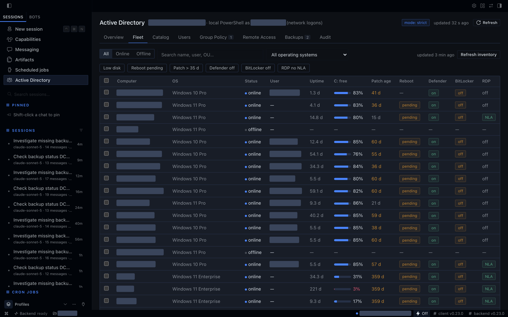 | 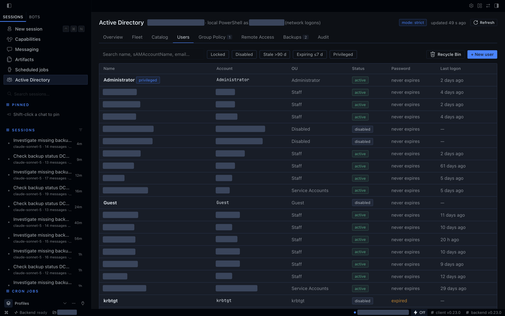 | 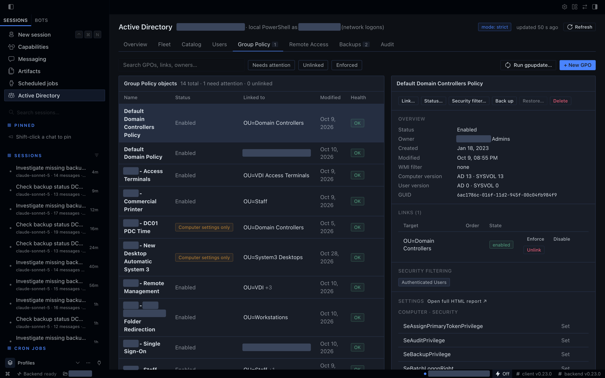 |
| **Remote Access** | **Backups** | **Audit** |
| 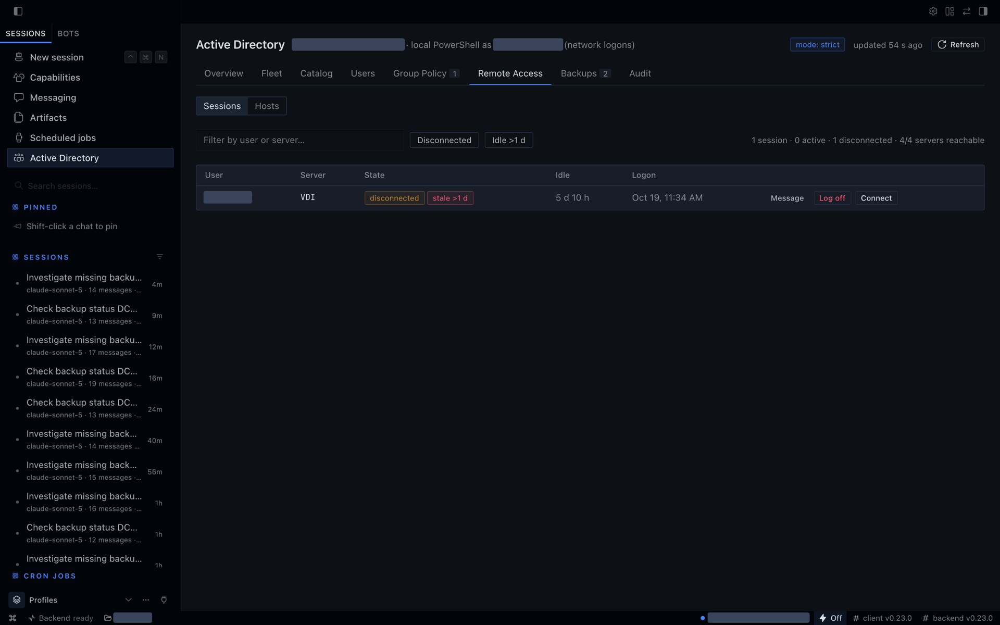 | 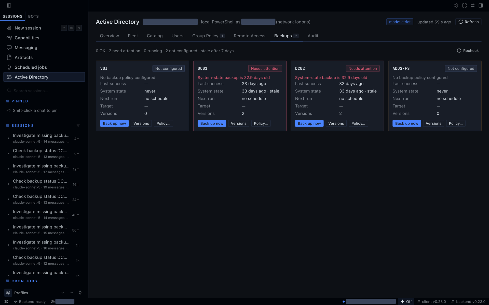 | 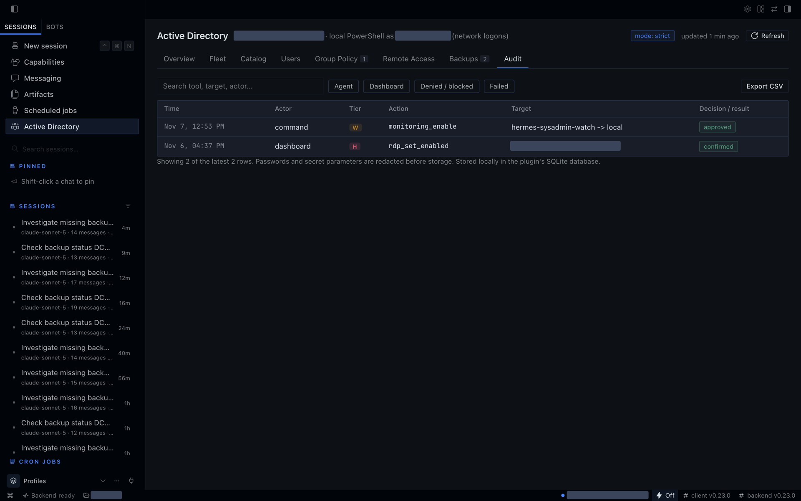 |

## License

MIT
